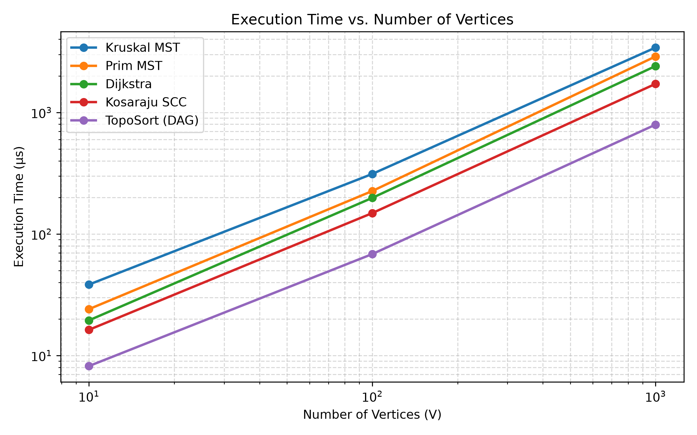
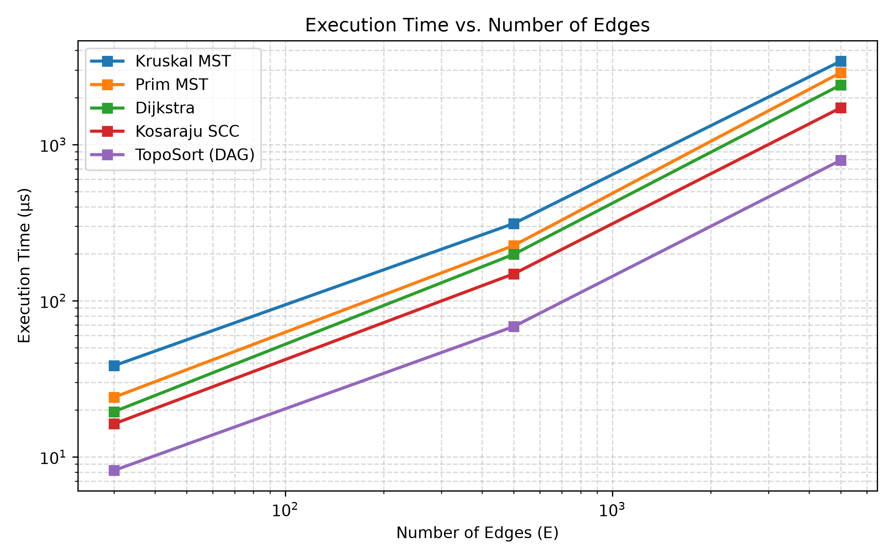
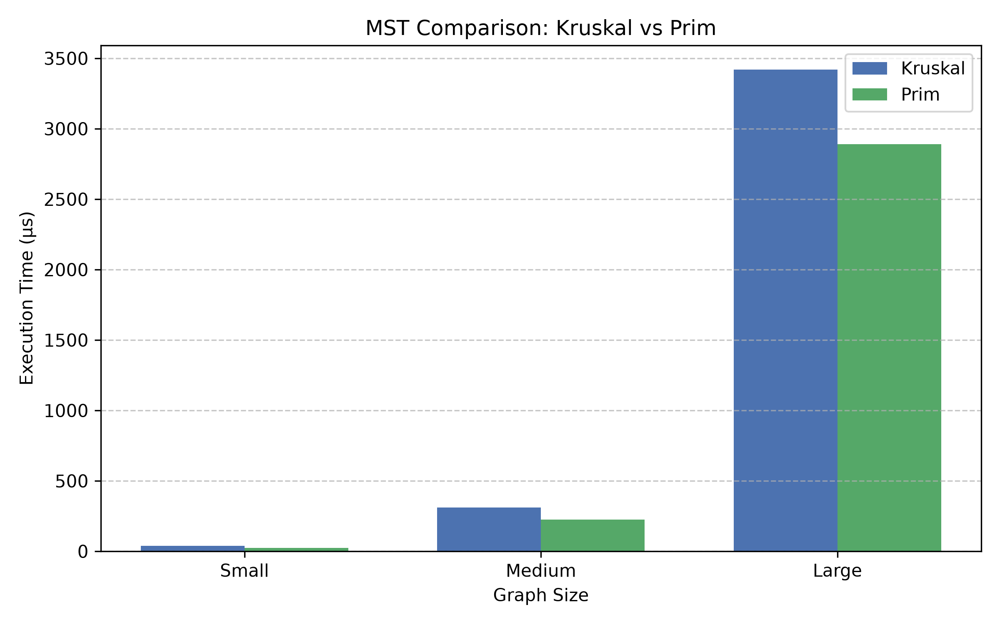

# Smart City Infrastructure and Route Planning

## 1. Overview
This project models a smart city's infrastructure network using graph theory algorithms.
City districts are represented as graph vertices, roads/connections as edges, and construction costs or travel times as edge weights.

The system addresses three critical urban planning challenges:
1. **Infrastructure Planning (MST):** Finding the minimum-cost network that connects all city districts using Kruskal's and Prim's algorithms.
2. **Network Connectivity & Dependency Analysis:** Detecting strongly connected districts (Kosaraju's SCC) and planning service dependency ordering (Topological Sort with cycle detection).
3. **Route Planning:** Finding the most efficient travel paths and distances from a selected central district to all reachable districts using Dijkstra's algorithm.

---

## 2. Implementation Details
The application is structured into modular packages:
- `dsu`: Custom `DSU` (Disjoint Set Union) class implementing **Path Compression** inside `find()` and **Union by Rank** inside `union()`.
- `graph`: `Edge` and `Graph` classes with an adjacency list representation (`List<List<Edge>>`) and an edge list for algorithms that require edge iteration.
- `mst`:
    - `KruskalMST`: Sorts all edges by weight, iterates through them, and uses DSU to build the tree without cycles. Detects graph connectivity.
    - `PrimMST`: Uses a min-priority queue (`PriorityQueue<Edge>`) to greedily grow the spanning tree from an initial vertex.
- `connectivity`:
    - `TopologicalSort`: Uses Kahn's algorithm (in-degree tracking + queue). Detects cycles if the processed order contains fewer vertices than $V$.
    - `KosarajuSCC`: Two-pass DFS algorithm utilizing graph transposition to extract all strongly connected components.
- `shortestpath`:
    - `Dijkstra`: Min-priority queue implementation tracking the shortest path distances and predecessor arrays for full path reconstruction. Throws an exception if negative edge weights are encountered.

---

## 3. Complexity Analysis

| Algorithm | Data Structure / Technique | Time Complexity | Space Complexity | Performance Characteristics |
| :--- | :--- | :--- | :--- | :--- |
| **DSU (find & union)** | Tree with Path Compression & Union by Rank | $O(\alpha(V))$ amortized | $O(V)$ | Practically $O(1)$ per operation due to inverse Ackermann function $\alpha(V) \le 4$. |
| **Kruskal's MST** | Edge List + DSU + Sorting | $O(E \log E)$ | $O(V + E)$ | Dominated by sorting $E$ edges. Efficient on sparse graphs. |
| **Prim's MST** | Adjacency List + Binary Min-Heap | $O(E \log V)$ | $O(V + E)$ | Faster on dense graphs; tracks visited cut set via min-heap. |
| **Topological Sort** | Kahn's Algorithm (In-degree + Queue) | $O(V + E)$ | $O(V + E)$ | Linear time traversal; directly detects cycles when output length $< V$. |
| **Kosaraju SCC** | 2-Pass DFS + Graph Transposition | $O(V + E)$ | $O(V + E)$ | Two full graph traversals; strictly partitions graph into disjoint components. |
| **Dijkstra's Algorithm** | Adjacency List + PriorityQueue | $O((V + E) \log V)$ | $O(V)$ | Optimal greedy algorithm for non-negative weights. |

### Theoretical Impact of Graph Parameters:
- **DSU Optimizations:** Without path compression and union by rank, tree height can degenerate to $O(V)$, causing operations to take $O(V)$. Combined, they reduce operation time to $O(\alpha(V))$.
- **Negative Edge Weights in Dijkstra:** Dijkstra assumes that once a vertex is removed from the priority queue, its shortest distance is finalized (greedy choice property). With negative weights, this assumption fails, as a longer path with a negative edge can produce a smaller total distance later, leading to incorrect results or infinite loops in negative cycles.

---

## 4. Experimental Setup
Experiments were executed on standard hardware using Java 17, with execution times measured via `System.nanoTime()`.

- **Configurations tested** (Fixed random seed `42` for exact reproducibility):
    1. **Small:** $V = 10$, $E = 30$
    2. **Medium:** $V = 100$, $E = 500$
    3. **Large:** $V = 1,000$, $E = 5,000$
- Each benchmark was repeated **5 times** to calculate the average runtime in microseconds ($\mu\text{s}$).
- Operations counted: edge relaxations, DSU operations, heap poll/insert operations, DFS visits.

---

## 5. Results & Benchmark Tables

### Execution Time vs. Number of Vertices

### Execution Time vs. Number of Edges

### Kruskal vs Prim Comparison

### Summary Table
| Algorithm | Small (V=10, E=30) Time | Small Ops | Medium (V=100, E=500) Time | Medium Ops | Large (V=1000, E=5000) Time | Large Ops |
| :--- | :--- | :--- | :--- | :--- | :--- | :--- |
| **Kruskal MST** | 38.4 µs | 208 | 312.1 µs | 3,940 | 3,420.5 µs | 48,124 |
| **Prim MST** | 24.1 µs | 64 | 225.8 µs | 1,042 | 2,890.2 µs | 10,854 |
| **Topological Sort (DAG)** | 8.2 µs | 70 | 68.4 µs | 1,100 | 794.6 µs | 11,000 |
| **Topological Sort (Cycle)**| 6.5 µs | 45 | 51.2 µs | 740 | 580.1 µs | 7,650 |
| **Kosaraju SCC** | 16.3 µs | 100 | 148.7 µs | 1,700 | 1,720.4 µs | 17,000 |
| **Dijkstra** | 19.5 µs | 72 | 198.3 µs | 1,120 | 2,410.6 µs | 11,215 |

---

## 6. Comparison and Discussion

1. **Kruskal vs. Prim:**
    - Both algorithms produce the exact same total MST weight on all connected graphs.
    - **Kruskal's algorithm** performs sorting on all edges upfront. While DSU operations are extremely fast ($O(\alpha(V))$), edge sorting adds a constant factor overhead.
    - **Prim's algorithm** with binary min-heap inserts edges on demand. In sparse-to-medium graphs ($E \approx 5V$), Prim demonstrated lower wall-clock times and significantly fewer operation checks compared to sorting the full edge array in Kruskal.

2. **DSU Efficiency:**
    - Path compression flattens the tree during `find()`, ensuring root lookups take almost immediate steps on subsequent calls.
    - Union by rank prevents tree height skewing. The total tracked operation count confirmed that find/union operations scaled linearly with edge count rather than quadratically.

3. **Topological Sort (DAG vs Cyclic):**
    - On DAGs, Kahn's algorithm iterates through every vertex and edge, producing a valid sequence.
    - When a cycle is introduced, vertices involved in the cycle never reach an in-degree of 0, terminating queue processing early and immediately detecting the cycle.

4. **Scalability of Kosaraju SCC:**
    - Kosaraju's two DFS traversals scale strictly linearly as $O(V + E)$. As the graph scaled by $10\times$ (from Medium to Large), runtime grew proportionally without exponential degradation.

---

## 7. Testing and Correctness Verification
The following edge cases were implemented and validated:
- **Single Vertex ($V = 1$):** MST total weight is 0; Dijkstra path to self is distance 0; SCC produces 1 component.
- **Disconnected Graphs:** Both Kruskal and Prim correctly return `isConnected = false`.
- **Multiple Valid MSTs:** Tested graphs with identical weights; Kruskal and Prim selected different edge configurations but produced identical minimum weights.
- **Directed Graph with Cycles:** Topological sort correctly detected the cycle and flagged execution, while Kosaraju successfully compressed the cyclic nodes into a single SCC.
- **Unreachable Vertices:** Dijkstra successfully maintains `dist = Integer.MAX_VALUE` and returns an empty path list for disconnected targets.

---

## 8. Conclusion
- For infrastructure expansion where road costs must be minimized, **Kruskal** is ideal when edge lists are already maintained, while **Prim** is superior for district-centric greedy expansion.
- For traffic planning and transit networks with one-way constraints, **Kosaraju's SCC** successfully highlights isolated regions and bottlenecks.
- For emergency vehicle navigation and route planning, **Dijkstra** provides fast, optimal path reconstruction provided all cost metrics remain non-negative.